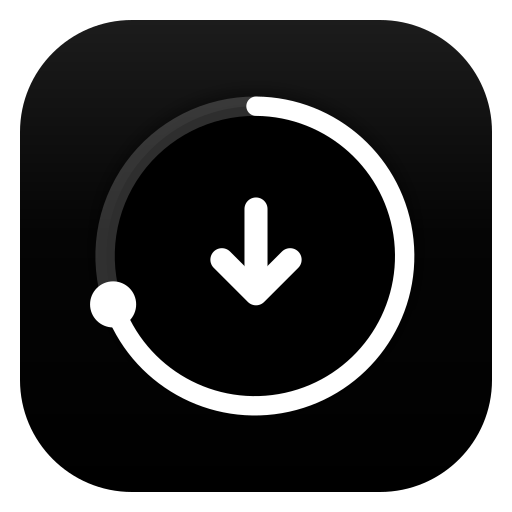
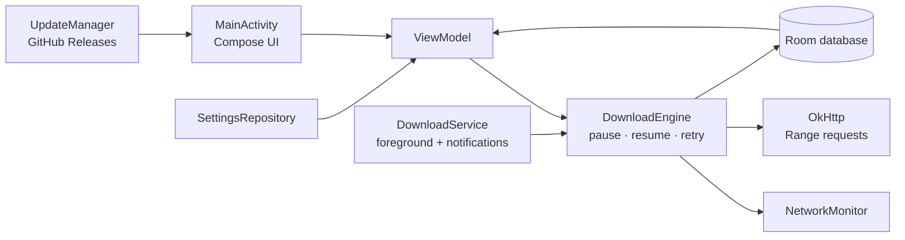

<div align="center">



# Downix

### The download manager Android should have shipped with.

Paste a link. Tap **Connect**. Downix checks it, downloads it in the background,<br>
resumes it when the network drops, and keeps everything in one clean AMOLED-dark list.

<br>

[](https://github.com/darkrider13/Downix/releases/latest)
[](https://github.com/darkrider13/Downix/releases)
[](https://github.com/darkrider13/Downix/actions/workflows/release.yml)
[](https://github.com/darkrider13/Downix/commits/main)

[](#requirements)
[](https://kotlinlang.org)
[](https://developer.android.com/jetpack/compose)
[](#why-downix)
[](#privacy)

<br>

[**Download APK**](https://github.com/darkrider13/Downix/releases/latest) ·
[Features](#features) ·
[How it works](#how-it-works) ·
[Architecture](#architecture) ·
[Build from source](#build-from-source) ·
[Releases](#releases-and-updates)

</div>

<br>

---

## Why Downix

Most Android download managers are either bloated with ads or too bare to trust with a large file. Downix is built around one idea: **a download should just finish**, and the app should stay out of your way while it does.

| | |
|---|---|
| **Fast** | Native Kotlin and Jetpack Compose. Scrolling and animations run on the GPU layer, so the list stays smooth even on budget phones. |
| **Reliable** | Pause, resume, auto-retry and network awareness. A dropped connection does not mean starting over. |
| **Private** | No account, no ads, no analytics. The only network calls are your downloads and the update check. |
| **Beautiful** | AMOLED dark glass design with soft, lightweight motion and instant background blur. |

---

## Features

<table>
<tr>
<td width="50%" valign="top">

### Downloading
- **Link check first.** *Connect* verifies a link before anything is saved, so broken links are caught early.
- **Pause and resume** any time, using HTTP `Range` requests.
- **Background downloads** through a foreground service with live notifications, even when the app is closed.
- **Smart engine.** Waits while you are offline, resumes by itself and retries failed downloads.
- **Parallel downloads.** Choose how many files run together (1 to 5).
- **Wi-Fi only mode** to never touch mobile data.

</td>
<td width="50%" valign="top">

### Organising
- **Filters and search.** *All*, *Active*, *Completed* and *Failed* tabs with live counts, plus search by name or link.
- **Details popup.** Name, link, size, date, status and location, with one-tap copy.
- **File actions.** Open, share or delete the downloaded file from inside the app.
- **Duplicate detection.** Downix tells you when a link is already in your list.
- **Clipboard suggestion.** Copied a link? Pick it up from *From clipboard*.
- **Multi-select** to remove several downloads at once.
- **Share and open-with.** Send a link to Downix from any app.

</td>
</tr>
<tr>
<td width="50%" valign="top">

### Design and motion
- **AMOLED dark theme** with glass surfaces and a minimal layout.
- **Instant background blur** behind every popup (Android 12 and above).
- **Edge-fading list.** Cards fade and shrink slightly as they leave the screen.
- **Smart + button.** It fades away while you scroll, returns only at the very top, and never hides while its menu is open.
- Large touch targets and consistent red, white and green button rules.

</td>
<td width="50%" valign="top">

### Updates
- **In-app updates** from GitHub Releases. Downix checks on start and installs the new build over the old one.
- Updates are **verified** (same package, higher version, same signing key) before install.
- Your downloads and settings are kept across updates.

</td>
</tr>
</table>

---

## Install

1. Open the [**latest release**](https://github.com/darkrider13/Downix/releases/latest).
2. Download `Downix-<version>.apk`.
3. Open it on your phone and allow **Install unknown apps** if Android asks.

After the first install, new versions arrive inside the app: **Settings → Updates → Check now**.

### Requirements

| | |
|---|---|
| Android | 7.0 (API 24) or newer |
| Blur effect | Android 12 (API 31) or newer |
| Permissions | Internet, network state, notifications, foreground service |

---

## How it works

```text
  +  ──►  Add link / From clipboard  ──►  Connect (link check)  ──►  Download
                                                                        │
              Open · Share · Delete  ◄──  Completed  ◄──  Pause · Resume · Retry
```

1. Tap **+** and choose **Add link** or **From clipboard**.
2. Paste the link and tap **Connect**. Downix checks the file and shows its status.
3. Start the download. Progress, speed and size are live on the card.
4. Pause, resume or remove it whenever you like. Finished files go to your download folder, which you can change in **Settings**.

---

## Settings

| Setting | What it does |
|---|---|
| Download folder | Where finished files are saved |
| Simultaneous downloads | How many files download at once (1 to 5) |
| Wi-Fi only | Never use mobile data |
| Notifications | Alert when a download finishes or fails |
| Updates | Check for a new version of Downix |

---

## Architecture



The UI never talks to the network. It observes the database, and the engine writes progress into it, so the list stays correct even if the app is killed and reopened.

### Tech stack

| Area | Technology |
|---|---|
| Language | Kotlin 1.9 |
| UI | Jetpack Compose, Material 3 |
| Networking | OkHttp 4 |
| Database | Room 2.6 (KSP) |
| Background work | Foreground service, Kotlin Coroutines |
| Build | Gradle (Kotlin DSL), Android Gradle Plugin 8.5, JDK 17 |
| Min / target SDK | 24 / 34 |

### Project structure

```text
Downix/
├── app/src/main/java/com/downix/app/
│   ├── MainActivity.kt         Main screen, popups, Settings screen, + menu
│   ├── DownixTheme.kt          Colours, glass surfaces, buttons, icons, list edge fade
│   ├── DownloadEngine.kt       Pause, resume, retry, network awareness
│   ├── DownloadService.kt      Foreground service and notifications
│   ├── DownloadDatabase.kt     Room database and repository
│   ├── DownloadTools.kt        Filters, search, details popup, copy and share actions
│   ├── LinkChecker.kt          Checks a link before it is added
│   ├── NetworkMonitor.kt       Connectivity and Wi-Fi state
│   ├── SettingsRepository.kt   Saved preferences
│   ├── SaveLocation.kt         Download folder handling
│   ├── UpdateManager.kt        In-app update checker and installer
│   ├── UpdateUi.kt             Update popup and Settings row
│   └── DeveloperCredit.kt      Developer credit shown in Settings
├── branding/                   App icon source (SVG) and 512 px PNG
└── .github/workflows/          Automatic build and release
```

---

## Build from source

You need **Android Studio** (latest stable) and **JDK 17**.

```bash
git clone https://github.com/darkrider13/Downix.git
cd Downix
```

Open the folder in Android Studio and run the `app` configuration on a device or emulator.

A signed release build needs the signing key (see [Signing key](#signing-key-one-time-setup)):

```bash
gradle :app:assembleRelease -PbuildNumber=5 -PupdateRepo=darkrider13/Downix
```

---

## Releases and updates

Every push to `main` runs **GitHub Actions** (`.github/workflows/release.yml`), which builds a **signed** APK and publishes it as a GitHub Release named `v1.0.<run number>`.

| | |
|---|---|
| **Version name** | `downix.versionBase` (in `gradle.properties`) + `.` + run number, for example `1.0.12` |
| **Version code** | The run number, so it always grows and Android accepts it as an update |
| **Visibility** | The repository must stay **public**, because the app reads the Releases API without a login |
| **Skipped builds** | Changes to Markdown files and `branding/` do not trigger a build |

### Signing key (one-time setup)

Every build must be signed with the **same key**, otherwise Android refuses to update over the installed app. Keep the key in a local `signing-private/` folder (it is in `.gitignore` and must never be committed), then add it to GitHub once under
**Settings → Secrets and variables → Actions**:

| Secret | Value |
|---|---|
| `KEYSTORE_BASE64` | Base64 text of the keystore file |
| `KEYSTORE_PASSWORD` | Store password |
| `KEY_ALIAS` | Key alias |
| `KEY_PASSWORD` | Key password |

> [!WARNING]
> Back up `signing-private/` somewhere safe. If the key is lost, users must uninstall Downix once to install a build signed with a new key.

---

## Privacy

Downix has no account, no ads and no analytics. It talks to the internet only to download the links you add and, if you allow it, to ask GitHub whether a newer release exists. Your download list and settings stay on your phone.

---

## Contributing

Found a bug or have an idea? [Open an issue](https://github.com/darkrider13/Downix/issues) and include your Android version and what you expected to happen.

---

<div align="center">

### Made with 💜 by [darkrider13](https://github.com/darkrider13)

<sub>If Downix saves you time, a ⭐ on the repository is the best thank-you.</sub>

</div>
